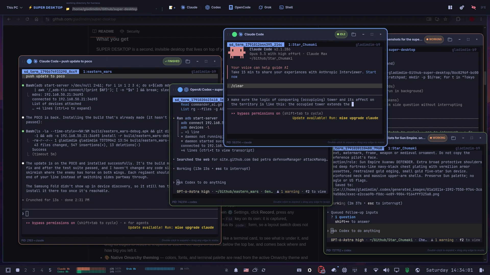
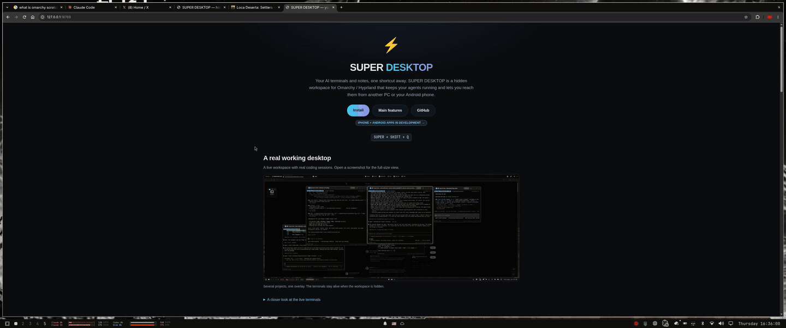
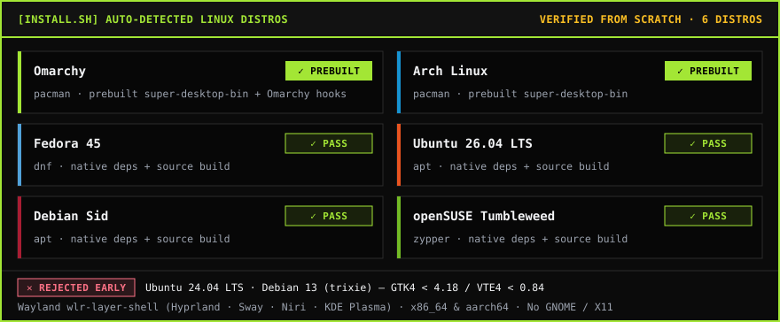
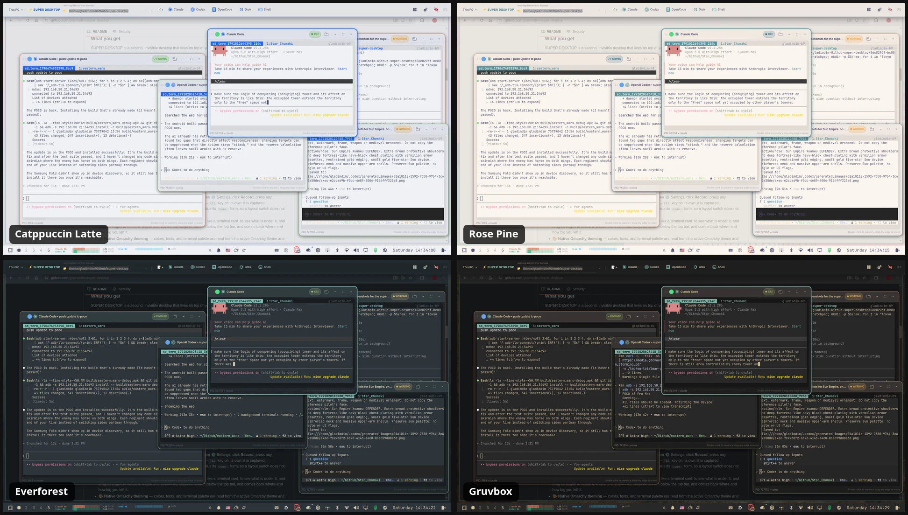

# ⚡ SUPER DESKTOP

[](https://github.com/gladimdim/super-desktop/actions/workflows/arch-packaging-check.yml)
[](#quick-install)
[](#quick-install)
[](#quick-install)
[](#quick-install)
[](#quick-install)
[](#quick-install)

> 🌐 **Website: [superdesktop.dmytrogladkyi.com](https://superdesktop.dmytrogladkyi.com/)** · 📱 **[Free Android APK](https://github.com/gladimdim/super-desktop/releases/download/v2.1.2/SUPER-DESKTOP-2.3.1.apk)** · **Android app: [SUPER DESKTOP on Google Play](https://play.google.com/store/apps/details?id=com.gladimdim.superdesktop)** · **iPhone and iPad: [App Store](https://apps.apple.com/app/super-desktop-ai-agents/id6818722591)**
>
> **A hidden overlay workspace for Hyprland / Omarchy with sticky notes and mini AI-terminal windows.**
> Press `SUPER + SHIFT + Q` — notes and AI terminals slide in from the screen edges. Press it again — everything disappears and your normal desktop is completely clean. All sessions keep running in background tmux.



<p align="center">
  
</p>

---

## Quick Install

On **Omarchy** or any compatible **Linux** desktop (`x86_64` / `aarch64`), open a terminal and run this command as your normal user (not with `sudo`):

```bash
curl -fsSL https://raw.githubusercontent.com/gladimdim/super-desktop/master/install.sh | bash
```

<picture>
  <source media="(prefers-color-scheme: dark)" srcset="docs/assets/distro-support-dark.svg">
  <source media="(prefers-color-scheme: light)" srcset="docs/assets/distro-support-light.svg">
  
</picture>

`install.sh` auto-detects your distro — installing the GPG-signed `super-desktop-bin` Pacman package on **Omarchy / Arch** (set `SUPER_DESKTOP_BUILD_FROM_SOURCE=1` to compile instead) or building from source with native dependencies on **Fedora 45+, Ubuntu 26.04+, Debian Sid, and openSUSE Tumbleweed**.

The installer does not run a full system upgrade. If a required library conflicts with an older installed package, run `omarchy update` (or `sudo pacman -Syu`) first and re-run the installer.

Press **SUPER + SHIFT + Q** (or run `super-desktop toggle`) to open the overlay, pick a project folder, and click a harness launcher. Replay the intro anytime from **⚙ Settings → Getting started guide** or `super-desktop tour`. Package installs update via `omarchy update` (`sudo pacman -Syu super-desktop-bin`); source installs update via **⚙ Settings → Updates** or by re-running the install command.

For Arch packages, version pinning, protocol compatibility, charger sleep lock, and headless boot, see [Installation, Packages, Versions & Power](guides/INSTALL.md). Installing via an AI agent? Follow [For AI Assistants & Project Layout](guides/AI_INSTALL.md).

---

## Guides

| Guide | What it covers |
| --- | --- |
| **[How to SETUP Telegram Bot + Group](guides/TELEGRAM.md)** | Create your own `@BotFather` bot, pair your account, link a 2-member Forum Topics group (1 card = 1 topic), and configure permissions. |
| **[Installation, Packages, Versions & Power](guides/INSTALL.md)** | Source/clone updates, Arch packages (`super-desktop-setup`), version pinning, protocol compatibility table, sleep lock, headless login launch. |
| **[Android App, Free APK & Phone Bridge](guides/MOBILE.md)** | Free Android APK download & changelog, LAN/Tailscale phone bridge, TV code pairing, mobile scrollback, voice/photo/file attachments. |
| **[Supported AI Harnesses, Terminals & SD Editor](guides/HARNESSES.md)** | 21 harnesses + shell, native adapters, custom & cloned launchers, launch parameters, terminal copy/paste, built-in SD Editor. |
| **[Use Another PC's Harnesses](guides/REMOTE_PCS.md)** | Pair two PCs, stream live remote workspaces, zoom/pan controls, and troubleshooting. |
| **[Plugins (QML Surfaces)](guides/PLUGINS.md)** | Build QML surfaces with AI, discover/install community plugins, edit locally, and publish. |
| **[Local MCP Access & CLI Quick Reference](guides/MCP_AND_CLI.md)** | Local stdio MCP server, structured CLI commands, idempotency receipts, and [complete CLI reference](CLI.md). |
| **[For AI Assistants & Project Layout](guides/AI_INSTALL.md)** | Exact Omarchy install rules for AI assistants, troubleshooting table, and repository layout. |
| **[Development, Signing & Releases](guides/DEVELOPMENT.md)** | Local clone builds, isolated test suite, GPG signing keys, cutting releases, and local/CI multi-arch signed Pacman package builds. |
| **[Security](SECURITY.md)** | Security boundaries for the phone bridge, PC-to-PC sync, Telegram BYOB worker, MCP, and plugins. |

---

## What you get


- **📝 Sticky notes** — autosaved notes with Omarchy theme colors, drag & drop, edge resize, and color tags.
- **💻 AI terminals** — live VTE4 terminal cards backed by tmux for Claude Code, Codex, OpenCode, Antigravity CLI, Grok, Pi, and more; folder-based tag colors, ghost outlines for buried cards, and **Alt+0 … Alt+9** quick switcher. See [Supported AI Harnesses, Terminals & SD Editor](guides/HARNESSES.md).
- **📎 Referenced files & attachments** — preview images, GIFs, sandboxed PDFs, and text/code directly from terminal output, or stage up to 20 files/images per card to insert into prompts.
- **✏️ Built-in SD Editor & 🧩 QML Plugins** — lightweight tree editor for the active folder plus live-reloading Qt Quick plugins you can generate or install with AI. See [Plugins](guides/PLUGINS.md).
- **✈ Telegram bot & Forum Topics** — control cards remotely using your own `@BotFather` bot over outbound HTTPS long-polling (no relay, no open ports), including 1-card-1-topic Forum supergroups, alerts, and granular permissions. Read **[How to SETUP Telegram Bot + Group](guides/TELEGRAM.md)**.
- **📱 Android app & 🖥 Remote PCs** — control cards from the [free Android APK](guides/MOBILE.md) or [Google Play app](https://play.google.com/store/apps/details?id=com.gladimdim.superdesktop), or stream and control another Linux PC's workspace in [Use Another PC's Harnesses](guides/REMOTE_PCS.md).
- **⌨️ CLI & Local MCP** — structured JSON inspection, guarded card launches, and a permission-controlled stdio MCP server. See [Local MCP Access & CLI Quick Reference](guides/MCP_AND_CLI.md) and the [CLI reference](CLI.md).
- **🎨 Native Omarchy theming** — colors, fonts, and terminal palette follow active Omarchy theme switches live:



---

### Keybindings

| Combo | Action |
|---|---|
| `SUPER + SHIFT + Q` | **Show / hide SUPER DESKTOP** — works in EN + UK layouts. Change it in ⚙ Settings → *Show / hide shortcut* |
| `Esc` | Hide SUPER DESKTOP |
| Pointer in the top-left corner, held 2s | Show / hide SUPER DESKTOP (8×8 px zone, no keyboard involved) |
| `Ctrl + N` | New note |
| `Ctrl + T` | New terminal |
| `Alt + Space` / `Ctrl + Shift + K` | Command Palette (also `Ctrl + K` outside terminal focus) — jump to cards, run `/` commands, or launch harnesses |
| `Ctrl + Shift + /` | Slash command launcher for the focused AI harness card |
| `Alt + W` | Jump to the next `WAITING` or `ERROR` card |
| `Alt + [` / `Alt + ]` | Cycle recently used cards |
| `Ctrl + Shift + F` / `M` / `P` / `O` / `A` | Expand, minimize, prompt history, files & links, or attach files on the focused card |
| Double-click terminal/header | Expand to 80% / collapse back |
| Right-click terminal header | Card menu (slash commands, restart fresh, resume conversation, prompt history, files & links, attach files) |
| Click the 📁 folder field | Choose the working directory for new harness cards (`Enter` = home, `▾` = folders used before) |

---

### Local MCP access

Configure an MCP client to launch the local stdio server (supports MCP `2025-11-25` and `2025-03-26`):

```json
{
  "mcpServers": {
    "super-desktop": {
      "command": "super-desktop",
      "args": ["mcp", "serve"]
    }
  }
}
```

Open **⚙ Settings → MCP** to enable access and choose access to terminal output and input, notes, layouts, files, history, editors, plugins and desktop administration, or copy ready-made client configuration. See [Local MCP Access & CLI Quick Reference](guides/MCP_AND_CLI.md) and [the MCP tool reference](CLI.md#local-mcp-tools).

---

## License

Copyright (c) 2026 Dmytro Gladkyi.

SUPER DESKTOP is licensed under the GNU General Public License, version 3 only
(`GPL-3.0-only`). You may redistribute and modify it under those terms. It is
provided without warranty; see [LICENSE](LICENSE) for the full terms.

Third-party dependencies and assets retain their own licenses. See the
[asset license notices](assets/logos/LICENSES.md) and
[attribution](assets/logos/ATTRIBUTION.md) for bundled logos and icons.
